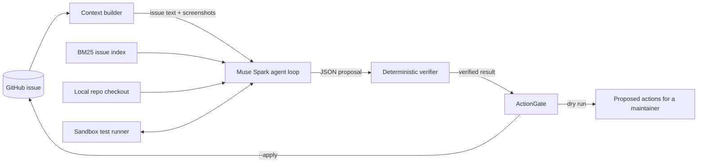

# Architecture

## Overview

## Components

- **Context builder (`workflows.build_context`):** this fetches the issue, its comments, the repository's labels and up to 300 recent issues, and it makes a shallow clone of the repository. The issue list is cached under `.custodian/cache` so repeated runs are fast.
- **Agent loop (`agent.py`):** this is a plain tool-calling loop with a step budget. When the budget runs out, the model is asked for its final answer without tools, so a run always ends with a proposal.
- **Tools (`tools.py`):** the agent can list, read, and grep files, search and read other issues, write test files in the local checkout and run allow-listed test commands. None of these tools can change anything on GitHub.
- **Verifiers (`workflows.verify_*`):** each workflow has a verifier that checks the proposal against reality. This is the part of the system that makes the agent's output trustworthy and it is where most of the engineering effort goes.
- **ActionGate (`policy.py`):** this is the only code that holds GitHub write access. It allows two action types (adding existing labels and posting a comment), applies limits and records every decision so a maintainer can audit it.
- **Executors (`executors.py`):** these decide where tests run. The local executor runs them on this machine; the Modal executor runs them in a Modal Sandbox with networking blocked. Both enforce the same command allow-list.

## Why verification is deterministic

- A second model call that "checks" the first one can share the same blind spots, so the verifiers use facts the system can observe directly: whether a file exists, whether a label exists and whether a test really fails when we run it.
- This also gives the evaluation a useful number: the over-claim rate, which is how often the agent said it succeeded when verification showed it had not.

## Threat model

- **Prompt injection through issue text:** issue content is wrapped in tags and labeled as untrusted in the system prompt. Even if an injection succeeds, the gate means the worst outcome is an unhelpful comment.
- **Untrusted code execution:** the reproduction step runs the target repository's tests. The local runner uses an allow-list, no shell, path guards that stop the agent from writing anything other than test files and a timeout. With `CUST_SANDBOX=modal`, the same step runs in a Modal Sandbox that has no network access, so a malicious repository cannot reach this machine or the internet.
- **Noise for maintainers:** dry run is the default, comments are short and labeled as AI-drafted and unverified reproductions are never posted.

## Stretch goals (in priority order)

Goals marked **Implemented** were added after the hackathon, on a separate branch, so the hackathon submission itself is unchanged.

1. **Implemented: Modal Sandboxes (`executors.py`).** The repository is uploaded into a sandbox image and the setup commands in `CUST_SANDBOX_SETUP` run once while the image is built. Files the agent wrote or edited are left out of the image so Modal can reuse it from its cache, and they are copied into the sandbox before every command instead. One sandbox runs per workflow, with networking blocked, and it is shut down when the workflow ends.
2. Add a "suggested fix" workflow that proposes a patch as a draft pull request, gated by the reproduction test passing afterward.
3. Support JavaScript repositories by allow-listing `npm test` and `npx vitest`.
4. Accept voice bug reports, transcribed with Muse Voice Transcribe, for reporters who find it easier to describe a problem out loud.

## Ideas for later

- Run the evaluation's reproduction workflow in Modal Sandboxes in parallel, to evaluate compiled projects such as scikit-learn and pandas.
